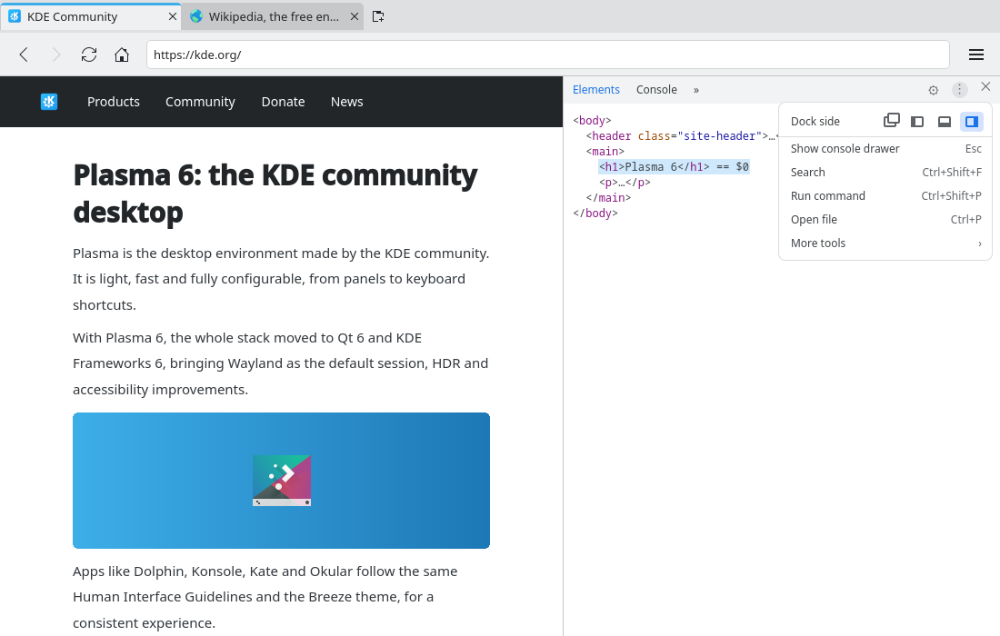
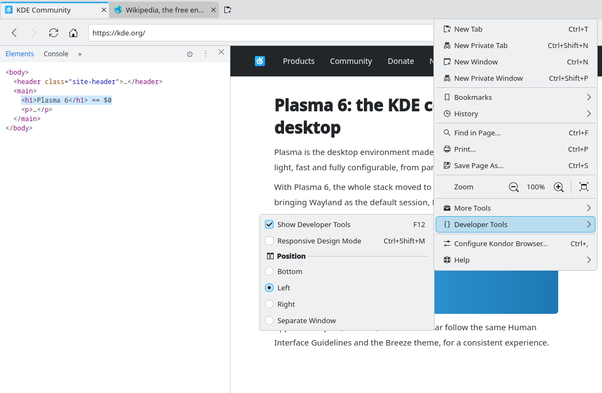
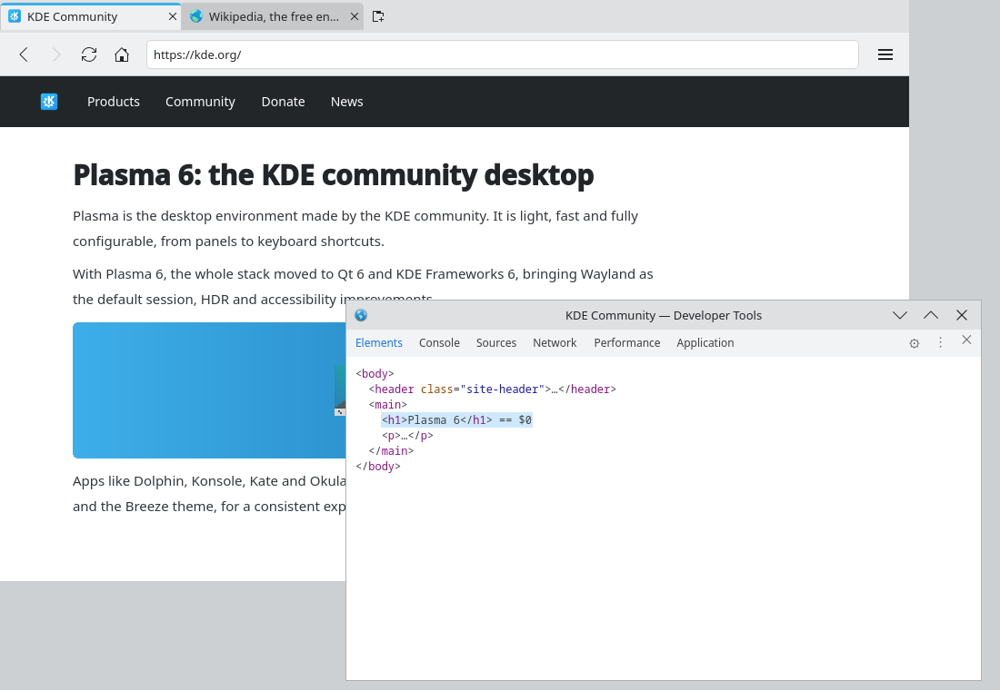

# Developer tools (#16)

> **Issue:** [#16](https://github.com/lukasborges/kondor/issues/16) · **Priority:** P2 (medium) · **State:** see the issue's label (`to-spec` / `to-dev` / `in-review`).
> Read [`AGENTS.md`](../../AGENTS.md) first. This file is the source of truth for the issue; only the architect edits it.

## Objective

Built-in developer tools (Chromium DevTools) toggled with F12 / Ctrl+Shift+I, docked in the window.

## Context

No DevTools. `WebEngineView` has the `devToolsView` / `inspectedView` properties and the `WebEngineView.InspectElement` web action.

## Design / behavior

1. **`Tab`**: `Q_PROPERTY(bool devToolsOpen …)` + `Q_INVOKABLE void toggleDevTools()` → `emit toggleDevToolsRequested()`; `Q_INVOKABLE void inspectElement()` → `emit inspectElementRequested()`.
2. **`WebViewTab.qml`**: wrap the page in a `SplitView { orientation: Qt.Vertical }` (or `Qt.Horizontal`, configurable later): the page `WebEngineView` and a second `WebEngineView { id: devTools; visible: root.tab.devToolsOpen; SplitView.preferredHeight: parent.height * 0.4 }`. When opening: `webView.devToolsView = devTools`; when closing: `webView.devToolsView = null`. Use the **same profile** as the page for the DevTools view.
3. `onInspectElementRequested`: open DevTools if closed, then `webView.triggerWebAction(WebEngineView.InspectElement)`.
4. DevTools' own `onWindowCloseRequested` (dock "×" in DevTools) → close the panel.
5. **Shortcuts/menu** in `Main.qml`: `F12` and `Ctrl+Shift+I` toggle; menu item "Developer Tools" (`code-context` or `document-properties`) under a "More Tools" submenu; "Inspect Element" in the page context menu (#13).
6. DevTools state is per tab; closing the tab closes its DevTools.

## Acceptance criteria

- [ ] F12/Ctrl+Shift+I opens DevTools docked at the bottom of the current tab and closes it again.
- [ ] Elements, Console and Network panels work for the inspected page.
- [ ] "Inspect Element" selects the right-clicked element.
- [ ] Switching tabs shows each tab's own DevTools state.

## Manual test

Open DevTools on kde.org, run `document.title` in the Console, inspect an image via the context menu, switch tabs, close with F12.

## Position (follow-up, maintainer's request)

DevTools can sit **below**, **left** or **right** of the page, or in a **separate window**, like
Chrome's "Dock side". The last choice is saved (`Settings.devToolsDockSide`: `bottom`, `left`,
`right` or `undocked`; default `bottom`) and used by the next DevTools that opens; DevTools already
open in other tabs keep their place.

1. **In DevTools itself**: the ⋮ menu shows Chromium's own "Dock side" row. Qt WebEngine hides it
   (it does not pass `can_dock=true` to the frontend), so `src/kondor/browser/devtools/devtoolsdocking.js`
   (a page script in the main world, like the responsive routing) adds the parameter, keeps
   DevTools' own layout whole (no empty area for the page, no screencast toggle), reports each
   change as the console message `kondor:devtools-dock:<side>` and exposes
   `kondorShowDockSide(side)` so Kondor can select the current side.
2. **In Kondor's menu**: a **Developer Tools** submenu right after More Tools holds
   **Show Developer Tools** (F12, checked while open), **Responsive Design Mode** and a
   **Position** section with the exclusive items **Bottom**, **Left**, **Right** and
   **Separate Window**. Choosing one moves the open DevTools, or opens them there.
3. **Per tab**: `tab.devTools` (`TabDevTools`) holds `dockSide`; `moveTo(side)` is the command,
   handled by `qml/browser/view/devtools/DevToolsLayout.qml`, which docks the view in the page's
   `SplitView` (resizable in every position) or moves it into `DevToolsWindow`
   ("<page title> — Developer Tools"). Closing that window closes DevTools.

## Out of scope

Remote debugging port settings.

## Dependencies

#13 for the context-menu entry.

## Prototype

Visual target — match it (controls, Kirigami components, icon names, wording, placement). If it disagrees with this spec, the spec wins.

**DevTools docked below the page** — [`prototypes/16-devtools.qml`](../../prototypes/16-devtools.qml)

**Dock side from DevTools' own menu** — [`prototypes/16b-devtools-dock-side.qml`](../../prototypes/16b-devtools-dock-side.qml)

**Developer Tools submenu with the position** — [`prototypes/16c-devtools-position-menu.qml`](../../prototypes/16c-devtools-position-menu.qml)

**Separate window** — [`prototypes/16d-devtools-separate-window.qml`](../../prototypes/16d-devtools-separate-window.qml)

## Decisions

Answers to developer questions (`question` label) are recorded here as `| Question | Decision |` rows.

| Question | Decision |
| --- | --- |
| Where does the position live in Kondor's menu? | A **Developer Tools** submenu of its own after More Tools (maintainer). A "Developer Tools Position" submenu inside More Tools (three levels deep) was rejected. Developer Tools and Responsive Design Mode moved out of More Tools into it. |
| How is DevTools' own "Dock side" row shown? | Kondor's DevTools script adds `can_dock=true` and swaps DevTools' docked layout for the undocked one, so no empty page placeholder appears; the screencast toggle that comes with it is hidden (it looked like a second device toolbar button). It uses DevTools internals (`AdvancedApp`, `DockController`, `ScreencastApp`); if they change in a Qt update, the menu in Kondor still works and the tests in `tests/browser/responsive/test_devtoolsdock.py` fail. |
| Global or per tab? | The last choice is global and remembered; each open DevTools keeps its own place, so a change does not pop out windows for every tab. A UI preference, so private tabs save it too. |
